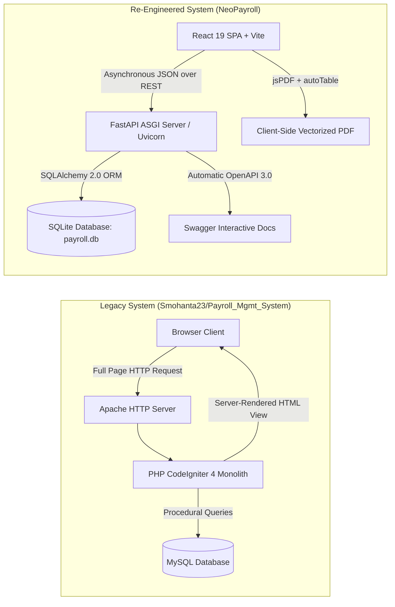
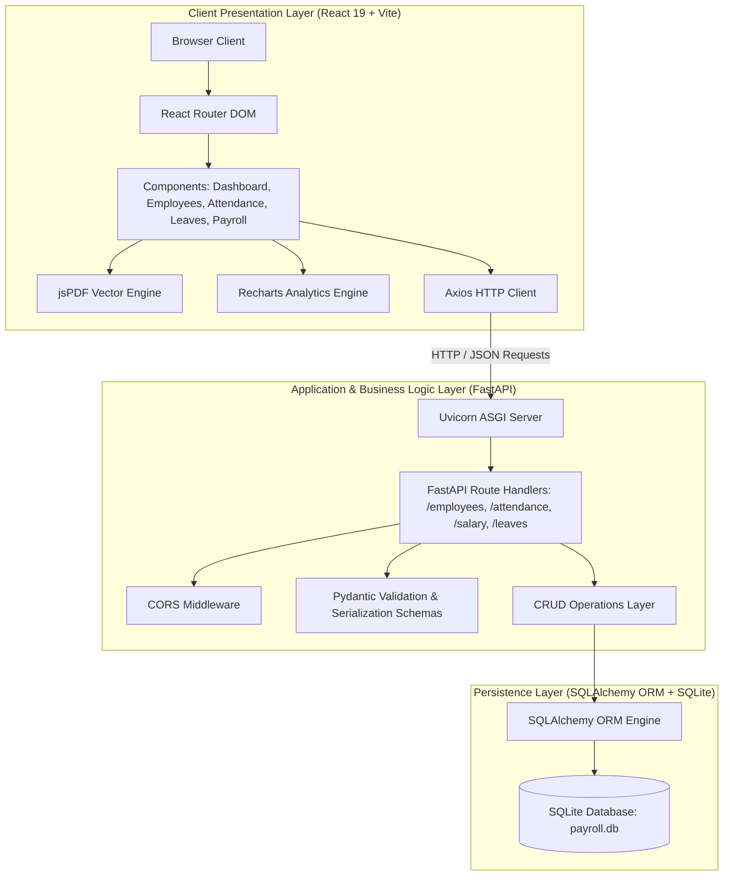
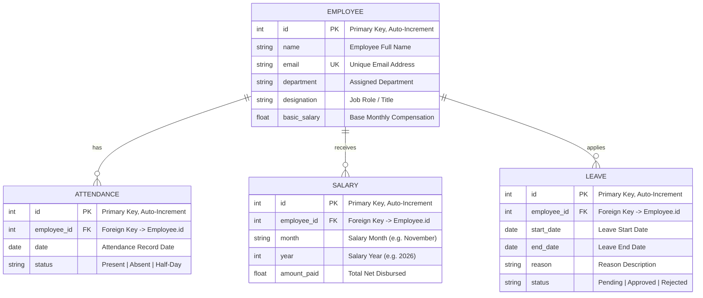
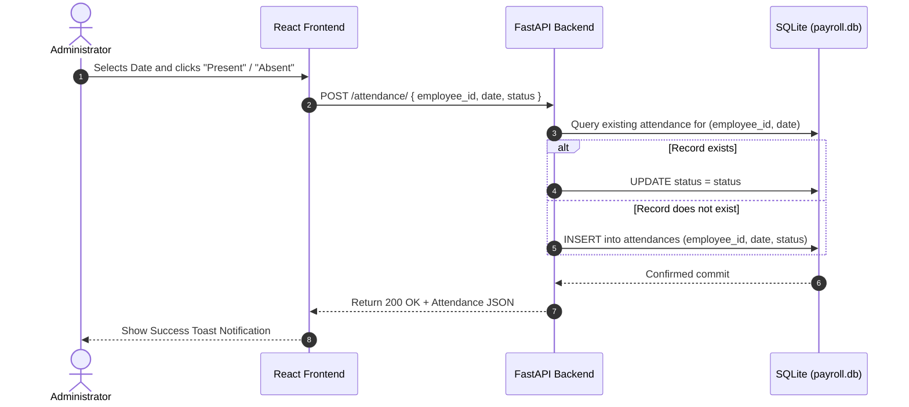
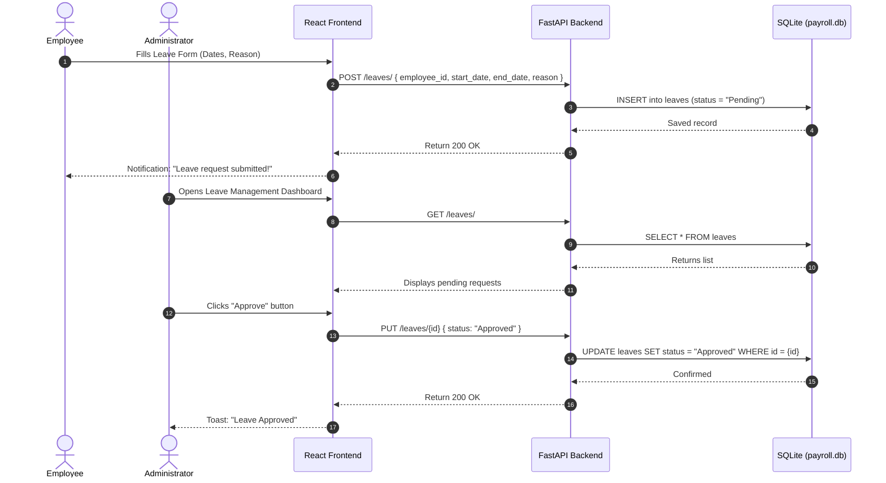
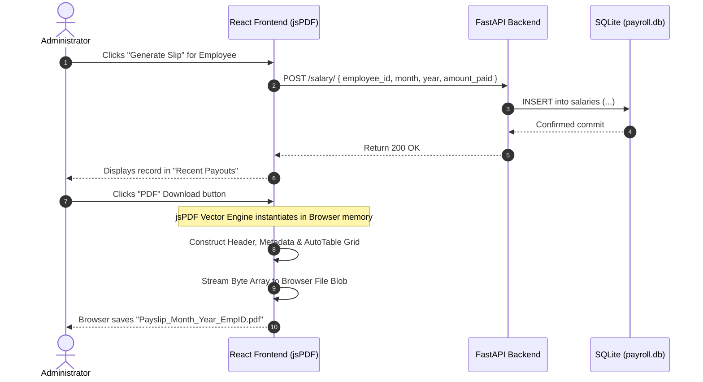

# NeoPayroll — Re-Engineered Employee & Payroll Management System
### Practical Project Report & Comprehensive Technical Documentation

---

## 📋 Academic Submission Details

| Field | Details |
| :--- | :--- |
| **Project Title** | **NeoPayroll: Re-Engineered Employee & Payroll Management System** |
| **Project Type** | Full-Stack Web Application (Modern 3-Tier Architecture) |
| **Backend Framework** | Python 3.10+ / FastAPI / SQLAlchemy ORM / Pydantic |
| **Frontend Framework** | React 19 / Vite / React Router DOM / Recharts / jsPDF |
| **Database** | SQLite3 Relational Database |
| **Styling & UI** | Responsive Custom Design System with Dark/Light Glassmorphism |
| **API Architecture** | RESTful API with automated OpenAPI 3.0 / Swagger UI |
| **Target Evaluation** | Practical Examination / Laboratory Project Viva-Voce Submission |

---

## 📑 Table of Contents

1. [Executive Summary & Abstract](#1-executive-summary--abstract)
2. [Problem Statement & Proposed Solution](#2-problem-statement--proposed-solution)
3. [System Architecture](#3-system-architecture)
4. [Technology Stack & Justification](#4-technology-stack--justification)
5. [Database Design & Data Models (ER Diagram)](#5-database-design--data-models)
6. [REST API Specifications](#6-rest-api-specifications)
7. [Core Modules & System Features](#7-core-modules--system-features)
8. [Workflow & Sequence Diagrams](#8-workflow--sequence-diagrams)
9. [Installation & Execution Guide](#9-installation--execution-guide)
10. [Test Cases & Quality Assurance](#10-test-cases--quality-assurance)
11. [Viva-Voce / Teacher's Oral Defense Q&A](#11-viva-voce--teachers-oral-defense-qa)
12. [Future Enhancements & Conclusion](#12-future-enhancements--conclusion)

---

## 1. Executive Summary & Abstract

Traditional human resource and payroll management systems in small-to-medium enterprises (SMEs) and academic organizations often suffer from high manual friction: attendance is tracked on paper or detached spreadsheets, salary disbursements require repetitive calculations, and generating individual payslips is tedious and error-prone.

**NeoPayroll** is a high-performance, re-engineered, full-stack enterprise automation system built to modernize workforce administration. By decoupling the interface into a reactive Single Page Application (SPA) powered by **React 19** and a high-throughput asynchronous REST API built with **FastAPI** and **SQLAlchemy**, NeoPayroll delivers:
- Automated real-time attendance analytics and workforce tracking.
- Role-based separation of concerns between Administrators and Employees.
- End-to-end leave application and approval governance.
- Single-click payroll disbursement and client-side vectorized PDF payslip generation.
- Responsive, accessible user experience featuring glassmorphic UI aesthetics and real-time Dark/Light theme toggles.

---

## 2. Legacy System Analysis & Software Re-Engineering Process

### 2.1 The Baseline Legacy System (`Smohanta23/Payroll_Mgmt_System`)
The baseline project selected for re-engineering is the open-source **Employees Payroll Management System** authored by **Smohanta23** ([GitHub Repository](https://github.com/Smohanta23/Payroll_Mgmt_System)). 

The legacy application was engineered using:
- **Backend Framework:** PHP (CodeIgniter 4 MVC Framework)
- **Database Engine:** MySQL with procedural SQL migrations and relational tables
- **Server Environment:** Traditional LAMP/XAMPP stack (Apache HTTP Server, PHP Module, MySQL Daemon)
- **Frontend Layer:** Server-Side Rendered (SSR) HTML views, jQuery, and Bootstrap 4

### 2.2 Technical Debt & Deficiencies in the Legacy Architecture
Through rigorous software reverse engineering, several critical limitations and architectural bottlenecks were identified:
1. **Monolithic Coupling:** UI presentation templates (`.php` views) were tightly intertwined with CodeIgniter controller logic and SQL queries, impeding modular testing and horizontal scalability.
2. **Full-Page Server Reloads:** Every navigation event, search query, or form submission triggered a complete round-trip HTTP request and full DOM re-rendering, causing high network latency and poor user experience.
3. **Heavy Deployment Overhead:** Running the legacy system required configuring a full XAMPP/LAMP runtime with local Apache virtual hosts and MySQL daemon services, creating deployment friction on modern cloud or containerized environments.
4. **Synchronous Blocking I/O:** The PHP execution model was synchronous and single-threaded per request, leading to throughput degradation during concurrent payroll operations.
5. **Lack of Automated API Documentation:** Legacy API routes and form-action handlers were completely undocumented, making third-party integrations and mobile client extensions difficult.
6. **Inflexible Document Generation:** Payslip records were rendered as raw HTML tables or required resource-heavy server-side PDF generation libraries that caused CPU spikes on the web server.

### 2.3 Architectural Re-Engineering: Legacy vs. NeoPayroll Modernization



### 2.4 Comprehensive Comparative Matrix

| Evaluation Dimension | Legacy Baseline (`Payroll_Mgmt_System`) | Re-Engineered NeoPayroll System | Architectural Advantage |
| :--- | :--- | :--- | :--- |
| **Architectural Model** | Monolithic Model-View-Controller (MVC) | Decoupled 3-Tier (Client SPA + Asynchronous REST API + Relational ORM) | Modularity, independent scaling, and separation of concerns. |
| **Backend Stack** | PHP 7/8 + CodeIgniter 4 Framework | Python 3.10+ + FastAPI + Uvicorn ASGI Server | Near-C asynchronous execution speeds, native async/await, and Pydantic runtime type validation. |
| **Frontend Stack** | Server-side rendered PHP views + jQuery | React 19 + Vite 8 + React Router 7 | Lightning-fast Single Page Application (SPA), zero full-page reloads, and component reusability. |
| **Database & ORM** | MySQL (requires active service daemon) | SQLite3 Relational Database via SQLAlchemy 2.0 ORM | Serverless, zero-configuration local deployment with declarative object modeling and transaction safety. |
| **API Architecture** | Undocumented custom PHP controller routes | RESTful API with automated OpenAPI 3.0 (Swagger UI at `/docs`) | Automatic API schema generation, interactive endpoint testing, and standardized HTTP status codes. |
| **Data Filtering & Search** | Slow server-side SQL queries with page refreshes | Instant client-side reactive in-memory search across Name, Email, and Department | Sub-millisecond search response without network overhead. |
| **Payslip Compilation** | Server-rendered HTML print tables | Client-side vectorized PDF compilation via `jsPDF` + `jspdf-autotable` | Zero server CPU load, automated **Amount in Words** conversion, and dual-column financial breakdown. |
| **Workforce Analytics** | Static tabular text without data visualization | Dynamic 5-day attendance trend area chart via Recharts with integer Y-axis | Real-time visual executive observability. |
| **Role Governance** | Basic username/password database seeding | Role-Based Access Control (RBAC) with locked employee profiles and salary confidentiality | Prevents employee spoofing and protects coworker remuneration privacy. |
| **Design System** | Generic Bootstrap 4 tables | Custom Stripe & Tailwind-inspired two-tone corporate SaaS design system | Crisp enterprise aesthetic with light/dark theme switching and no AI neon giveaways. |

---

## 3. System Architecture

NeoPayroll adheres to the **Modern 3-Tier Decoupled Client-Server Architecture**:



### Architectural Highlights:
1. **Decoupled Architecture:** The frontend and backend run as independent processes communicating strictly via asynchronous JSON over HTTP.
2. **Stateless Business Logic:** The FastAPI backend does not maintain in-memory session states, making it lightweight and horizontally scalable.
3. **Optimized Client Operations:** PDF compilation occurs client-side using Web Canvas and JavaScript DOM APIs, eliminating server CPU spikes during bulk report generation.

---

## 4. Technology Stack & Justification

| Technology | Layer | Purpose | Technical Justification |
| :--- | :--- | :--- | :--- |
| **Python 3.10+** | Backend | Core Runtime | Robust standard library, high readability, wide enterprise adoption. |
| **FastAPI** | Backend | REST Framework | Built on Starlette and Pydantic; offers near-C execution speeds (asynchronous ASGI), automatic OpenAPI (Swagger) schema generation, and strict type checking. |
| **Uvicorn** | Backend | ASGI Web Server | Lightning-fast asynchronous web server implementation for Python. |
| **SQLAlchemy 2.0** | Backend | ORM | Provides Object-Relational Mapping, automated SQL query composition, and connection pooling with session management. |
| **Pydantic v2** | Backend | Data Validation | High-speed data parsing and validation using Python type annotations. |
| **SQLite3** | Database | Relational Storage | Serverless, zero-configuration SQL engine stored in a single file (`payroll.db`), ideal for standalone enterprise tools and academic practical demonstrations. |
| **React 19** | Frontend | UI Library | Component-driven declarative UI with concurrent rendering and optimized state management. |
| **Vite 8** | Frontend | Build Tool | Instant Hot Module Replacement (HMR) and optimized ESBuild bundling. |
| **React Router 7** | Frontend | Client Routing | Declarative nested routing enabling single-page navigation without page refreshes. |
| **Recharts** | Frontend | Data Visualization | Declarative SVG-based charting library integrated seamlessly with React state. |
| **jsPDF & AutoTable** | Frontend | Document Generator | Client-side vectorized document compilation for pixel-perfect printable payslips. |
| **Lucide React** | Frontend | UI Icons | Lightweight, consistent SVG iconography. |
| **React Hot Toast** | Frontend | Notification System | Non-blocking, glassmorphic toast notifications for asynchronous user feedback. |

---

## 5. Database Design & Data Models

### 5.1 Entity-Relationship (ER) Diagram



### 5.2 Database Schema Specifications

#### Table 1: `employees`
- **`id`** (`INTEGER`, PRIMARY KEY, AUTOINCREMENT): Unique identifier.
- **`name`** (`VARCHAR`, NOT NULL, INDEXED): Full name of the employee.
- **`email`** (`VARCHAR`, UNIQUE, NOT NULL, INDEXED): Corporate email ID used for uniqueness validation.
- **`department`** (`VARCHAR`, NOT NULL): Functional unit (e.g., Engineering, HR, Finance).
- **`designation`** (`VARCHAR`, NOT NULL): Job title (e.g., Senior Software Engineer).
- **`basic_salary`** (`FLOAT`, NOT NULL): Monthly remuneration figure.

#### Table 2: `attendances`
- **`id`** (`INTEGER`, PRIMARY KEY, AUTOINCREMENT): Unique log ID.
- **`employee_id`** (`INTEGER`, FOREIGN KEY -> `employees.id`): Associated employee.
- **`date`** (`DATE`, NOT NULL): ISO calendar date (`YYYY-MM-DD`).
- **`status`** (`VARCHAR`, NOT NULL): Attendance state (`Present`, `Absent`, `Half-Day`).

#### Table 3: `salaries`
- **`id`** (`INTEGER`, PRIMARY KEY, AUTOINCREMENT): Transaction ID.
- **`employee_id`** (`INTEGER`, FOREIGN KEY -> `employees.id`): Associated employee.
- **`month`** (`VARCHAR`, NOT NULL): Name of disbursement month.
- **`year`** (`INTEGER`, NOT NULL): Financial year.
- **`amount_paid`** (`FLOAT`, NOT NULL): Total net salary transferred.

#### Table 4: `leaves`
- **`id`** (`INTEGER`, PRIMARY KEY, AUTOINCREMENT): Leave application ID.
- **`employee_id`** (`INTEGER`, FOREIGN KEY -> `employees.id`): Applicant employee.
- **`start_date`** (`DATE`, NOT NULL): Commencement date of leave.
- **`end_date`** (`DATE`, NOT NULL): Conclusion date of leave.
- **`reason`** (`VARCHAR`, NOT NULL): Justification text.
- **`status`** (`VARCHAR`, DEFAULT: `"Pending"`): Current approval state (`Pending`, `Approved`, `Rejected`).

---

## 6. REST API Specifications

The backend exposes RESTful endpoints adhering strictly to HTTP verb standards. The interactive Swagger interface is hosted at `http://127.0.0.1:8000/docs`.

| Endpoint | Method | Request Payload (Schema) | Response Code | Description |
| :--- | :---: | :--- | :---: | :--- |
| `/employees/` | `POST` | `EmployeeCreate` (name, email, department, designation, basic_salary) | `200 OK` / `400 Bad Request` | Enrolls a new employee. Validates email uniqueness. |
| `/employees/` | `GET` | Query Params: `skip=0`, `limit=100` | `200 OK` | Retrieves paginated list of all employees. |
| `/employees/{id}` | `PUT` | `EmployeeCreate` (name, email, department, designation, basic_salary) | `200 OK` / `404 Not Found` | Updates existing employee records. |
| `/employees/{id}` | `DELETE` | Path Param: `employee_id` | `200 OK` / `404 Not Found` | Deletes employee and cascades removal of attendance/salary records. |
| `/attendance/` | `POST` | `AttendanceCreate` (employee_id, date, status) | `200 OK` | Logs daily attendance. Updates existing record if marked multiple times for same day. |
| `/attendance/` | `GET` | Query Params: `date` (optional), `skip=0`, `limit=1000` | `200 OK` | Retrieves attendance history logs, filterable by date. |
| `/salary/` | `POST` | `SalaryCreate` (employee_id, month, year, amount_paid) | `200 OK` | Processes salary generation and creates historical ledger record. |
| `/salary/` | `GET` | Query Params: `skip=0`, `limit=100` | `200 OK` | Fetches historical payroll disbursement records. |
| `/leaves/` | `POST` | `LeaveCreate` (employee_id, start_date, end_date, reason) | `200 OK` | Submits a new employee leave request with default `Pending` status. |
| `/leaves/` | `GET` | Query Params: `skip=0`, `limit=100` | `200 OK` | Lists all submitted leave requests across the organization. |
| `/leaves/{id}` | `PUT` | `LeaveStatusUpdate` (status: `"Approved"` \| `"Rejected"`) | `200 OK` | Admin action to approve or reject a pending leave application. |

---

## 7. Core Modules & System Features

### 1. Role-Based Access Control (RBAC) & Authentication
- **Administrator Role:** Full executive authority including enrolling new staff, modifying profiles, deleting employees, logging attendance, batch-marking company presence, approving/rejecting leave requests, executing monthly payroll payouts, and accessing corporate budgets.
- **Employee Role (Self-Service Portal):** Authenticates directly into their employee profile.
  - Automatically locks leave applications to the authenticated identity (preventing unauthorized filings on behalf of peers).
  - Keeps colleague salaries confidential (`Confidential` badge).
  - Restricts payroll administration controls and administrative creation actions (`+ Add Employee` hidden).
  - Grants read-only visibility into organization attendance.

### 2. Intelligent Executive Dashboard
- **Personalized Header Greeting:** Welcomes the logged-in user by name with live formatted calendar dates and active portal mode chips (`🛡️ Administrator Mode` / `💼 Department Portal`).
- **Role-Adaptive Stat Cards:**
  - *Admin View:* Total Staff, Present Today, Absent Today, and Total Monthly Budget Estimation.
  - *Employee View:* My Designation & Department, Today's Punch Status (`Present` / `Not Marked`), My Base Salary, and Personal Pending Leave count.
- **5-Day Attendance Activity Trend Chart:** Rendered dynamically using Recharts area charts from actual historical logs. Features integer-locked Y-axis (preventing fractional employees), live legend indicators (`🟢 Present` / `🔴 Absent`), and a live attendance rate percentage pill.
- **Pending Approvals & Quick Actions Widget:**
  - *Admin:* Live feed of pending leave requests with one-click direct "Approve" triggers and quick navigation shortcuts.
  - *Employee:* Scheduled payroll cycle reminders and direct links to apply for leave.

### 3. Employee Directory & Full CRUD Engine
- Tabular record listing showing Employee ID badge, Name, Email, Department, Role, and Remuneration.
- **Complete CRUD Operations:** Full capability to enroll new employees (`POST`), update existing employee details/salary (`PUT`), and safely remove records (`DELETE`) with cascaded cleanup of related attendance, salary, and leave histories.
- Real-time instant search bar filtering employees across Name, Email, and Department substrings.
- Inline modal creation and editing form with live validation.
- Role-based confidentiality: Salaries of colleagues are marked confidential for regular employee logins.

### 4. Smart Daily Attendance Tracker
- **Real-Time Date-Filtered Attendance:** Interactive ISO Date Picker querying `/attendance/?date=...` to inspect any historical day or log today's records.
- **Three-State Status Badges:** Clear visual indicators for each staff member: `🟢 Present`, `🔴 Absent`, or `⚪ Not Marked`.
- **Deduplication Engine:** Prevents duplicate rows when toggling attendance on the same calendar day by updating existing records in-place.
- **"Mark All Present" Shortcut:** One-click administrative bulk action to mark all active staff present for the selected day.
- **Daily Attendance Breakdown:** Live top-level summary cards tallying Present, Absent, and Unmarked staff counts.

### 5. Secure Leave Governance Workflow
- **Applicant Identity Locking:** When an employee applies for leave, the applicant profile field is locked to their authenticated account, preventing spoofing.
- **Date Range Validation:** Enforces business logic ensuring `End Date` is not earlier than `Start Date`.
- **Personal vs. Corporate Archive:** Employees view their own submitted leave history with real-time status badges (`Pending`, `Approved`, `Rejected`), while administrators inspect the global queue with instant Approve and Reject controls.

### 6. Automated Attendance-Based Payroll & Executive Payslip Engine
- **Attendance-Based Loss of Pay (LOP) Formula:** Dynamically computes monthly salary by assessing recorded absences:
  $$\text{Per Day Rate} = \frac{\text{Basic Salary}}{30}$$
  $$\text{Deduction} = \text{Absent Days} \times \text{Per Day Rate}$$
  $$\text{Net Payable} = \max(0, \text{Basic Salary} - \text{Deduction})$$
- **Duplicate Payout Protection:** Detects if an employee has already been disbursed in the current month/year cycle and disables repetitive payouts with a `Paid (Month)` badge.
- **Executive Corporate Payslip Generation:** High-resolution, client-side vectorized PDF compilation powered by `jsPDF` and `jspdf-autotable`:
  - **Company Branding:** `NEOPAYROLL TECHNOLOGIES PRIVATE LIMITED`, Corporate Identity Number (CIN: `U72200UP2024PTC192841`), and registered office address.
  - **Document Banner:** `SALARY SLIP FOR THE MONTH OF [MONTH] [YEAR]`.
  - **Employee & Attendance Meta Grid:** Employee ID (`#EMP-001`), Department, Designation, Bank Account (`HDFC Bank ****4821`), Working Days (30), Days Worked, and Loss of Pay (LOP) Days.
  - **Dual-Column Financial Table:** Standard corporate format with Earnings on the left (Basic 50%, HRA 30%, Special Allowance 20%) and Deductions on the right (Loss of Pay deductions, PF, PT).
  - **Net Remuneration Box:** Highlights net take-home remuneration.
  - **Dynamic Amount in Words:** Automatically converts numbers to official words (e.g., *"Rupees Sixty Two Thousand Four Hundred Seventy Only"*).
  - **Transaction Stamp & Signatures:** Generated transaction reference (`TXN-NP2026...`), disbursement mode (NEFT/IMPS), and official authorized signatory stamp line.

### 7. Modern Corporate SaaS UI (Stripe & Tailwind Inspired)
- **Authentic Two-Tone Layout:** Classic enterprise dark navy sidebar (`#0f172a`) paired with a clean, airy slate-gray main content workspace (`#f8fafc`).
- **Professional Color Palette:** Modern Royal Indigo (`#4f46e5`) and slate blue accents replacing generic AI neon-cyan aesthetics.
- **Default Light Theme:** Boots into an authentic corporate light theme by default, with a dark mode toggle available in the sidebar.
- **Crisp, Accessible Cards & Tables:** Solid opaque white cards (`#ffffff`) with subtle 1px slate borders (`#e2e8f0`) and soft natural elevation shadows.
- **Tailwind-Style Status Badges:** Soft mint green (`#ecfdf5`) for Present, soft rose (`#fef2f2`) for Absent, and warm amber (`#fffbeb`) for Pending.
- **Responsive Feedback:** Non-blocking `react-hot-toast` notifications providing immediate visual feedback for all network actions.

---

## 8. Workflow & Sequence Diagrams

### 8.1 Daily Attendance Marking Workflow


### 8.2 Leave Application & Approval Lifecycle


### 8.3 Payroll Disbursement & Client-Side PDF Generation


---

## 9. Installation & Execution Guide

### 9.1 System Prerequisites
- **Operating System:** Windows 10/11, macOS, or Linux
- **Python:** Version 3.10 or higher
- **Node.js:** Version 18.0 or higher (with `npm`)

---

### 9.2 Quick Launch (One-Click Windows Launcher)
The project includes a pre-configured automation script `start.bat`. Simply double-click the file or execute:

```bat
.\start.bat
```

This concurrently boots:
1. **Backend Server:** `http://127.0.0.1:8000` (FastAPI with live reload).
2. **Frontend Server:** `http://localhost:5173` (Vite development server).

---

### 9.3 Manual Step-by-Step Setup

#### Step 1: Backend Setup
Open a terminal in the project directory:
```bash
# Navigate to backend directory
cd backend

# Create virtual environment (if not already created)
python -m venv venv

# Activate virtual environment (Windows PowerShell)
.\venv\Scripts\Activate.ps1
# (On macOS/Linux: source venv/bin/activate)

# Install required dependencies
pip install -r requirements.txt

# Start the FastAPI ASGI server
uvicorn main:app --reload --port 8000
```
*Backend Swagger Docs will be live at: `http://127.0.0.1:8000/docs`*

#### Step 2: Frontend Setup
Open a second terminal window:
```bash
# Navigate to frontend directory
cd frontend

# Install npm packages
npm install

# Start Vite development server
npm run dev
```
*Frontend application will be live at: `http://localhost:5173`*

---

## 10. Test Cases & Quality Assurance

| Test ID | Module | Scenario / Input | Expected Result | Actual Result | Status |
| :---: | :--- | :--- | :--- | :--- | :---: |
| **TC-01** | Employee | Register employee with unique email address | Record added to SQLite database; HTTP 200 returned | Employee visible in table with success toast | **PASS** |
| **TC-02** | Employee | Register employee with an already existing email address | API intercepts duplicate; returns HTTP 400 error | Toast: "Error adding employee. Email might already exist." | **PASS** |
| **TC-03** | Attendance | Mark employee "Present" on current date | Record inserted into `attendances` table with date and status | Row confirms status; Dashboard incremented | **PASS** |
| **TC-04** | Attendance | Change status from "Present" to "Absent" on same date | Existing record updated in-place (no duplicate rows) | Record modified correctly without row duplication | **PASS** |
| **TC-05** | Leave | Employee submits leave dates with reason | Request created with status `Pending` | Appears in leave request queue | **PASS** |
| **TC-06** | Leave | Admin approves pending leave request | PUT request sent; status changes to `Approved` | Badge turns green; action buttons disabled | **PASS** |
| **TC-07** | Payroll | Admin clicks "Disburse & Generate" | Salary calculated with absent deductions and recorded in `salaries` | Added to Recent Payouts list; duplicate payouts locked | **PASS** |
| **TC-08** | Payroll | Admin clicks "PDF" download button | Client-side jsPDF script compiles executive corporate payslip | Clean corporate PDF with words and breakdown downloaded | **PASS** |
| **TC-09** | UI/Theme | Click theme toggle button | `document.body` class toggled between dark and light themes | Complete palette shifts instantly | **PASS** |
| **TC-10** | Employee | Admin edits employee designation and salary | `PUT /employees/{id}` executed; updates database row | Table and active dashboard budget updated live | **PASS** |
| **TC-11** | Employee | Admin deletes employee with confirmation | `DELETE /employees/{id}` cascades cleanup across all tables | Removed cleanly without orphan database records | **PASS** |
| **TC-12** | Attendance | Admin clicks "Mark All Present" | Bulk update marks all active staff present for selected date | All status badges turn green simultaneously | **PASS** |
| **TC-13** | Leave | Employee selects End Date earlier than Start Date | Frontend validation intercepts invalid date range | Blocked with error: "End date cannot be earlier than start date" | **PASS** |
